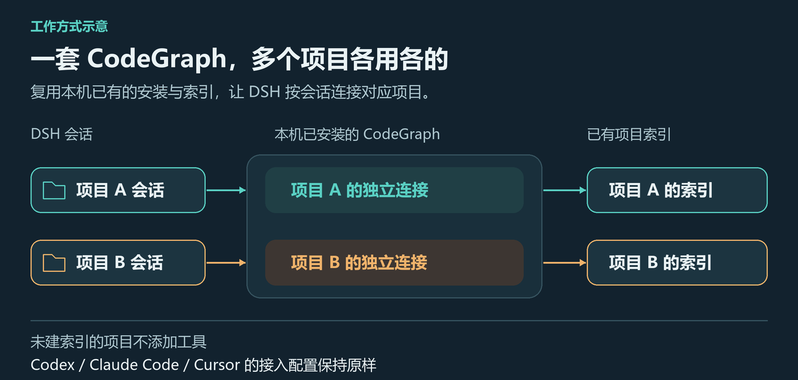

<div align="center">


# dsh-codegraph-project

**让 DeepSeek Harness（DSH）直接使用你已安装的 CodeGraph，多项目同时工作时，各查各的仓库。**

[](https://www.npmjs.com/package/dsh-codegraph-project)
[](https://github.com/deepseek-ai/deepseek-harness)
[](#license)

[CodeGraph 原项目](https://github.com/colbymchenry/codegraph) · [快速开始](#-快速开始) · [怎么使用](#-怎么使用) · [常见问题](#-常见问题)

</div>

## 它解决什么问题

> 已有 CodeGraph，接上 DSH；多个项目，分别查询。

[CodeGraph](https://github.com/colbymchenry/codegraph) 能帮助 AI 理解代码、查找调用关系和分析修改影响。如果你已经在 Codex、Claude Code 等工具中使用它，本插件让 DSH 也能用上同一套本机 CodeGraph 和已有项目索引。

- 🔌 **已有的直接用。** 不需要为了 DSH 再装一份 CodeGraph，也不必为接入本插件重建已有索引。
- 🗂️ **多项目同时用。** 可以同时打开多个项目的会话，每个会话使用自己项目的索引，无需来回修改全局配置。
- 🤝 **保留其他智能体的接入。** 不改写 Codex、Claude Code、Cursor 的 CodeGraph 配置，也不替换它们已配置的服务。
- 🧹 **方便停用和卸载。** 插件不会自动建索引，也不会在卸载时删除 CodeGraph 或项目索引；它管理的连接和进程会随插件释放。



你只需要让 DSH 会话打开正确的项目，插件会负责找到对应索引并提供工具。

## 🚀 快速开始

### 1. 准备 CodeGraph 和项目索引

> **已有环境可跳过：** 如果已安装 CodeGraph，且目标项目已有索引，直接从[第 2 步安装本插件](#2-安装本插件)开始，无需重新安装或初始化。

```powershell
# 确认本机 CodeGraph 可用，无需重复安装
codegraph --version

# 仅在项目还没有索引时，进入项目建立索引
Set-Location 'D:\path\to\your-project'
codegraph init
```

将示例路径替换成你的项目目录。`codegraph init` 在该项目中建立 `.codegraph/` 索引；每个要使用的项目分别执行一次。已有索引不必为安装本插件重新初始化。

如果还没装 CodeGraph，可先运行 `npm install -g @colbymchenry/codegraph`。安装后重启 DSH，确保它能找到新安装的命令。

### 2. 安装本插件

选择你使用的 DSH 入口，按对应方式安装即可。

#### 桌面端安装

打开侧栏的 **Plugins（插件）** 页面，在安装入口输入下面的 npm 包名，并完成安装：

```text
dsh-codegraph-project
```

#### 命令行安装

安装到你实际使用的 profile（配置环境）。例如使用 `web`：

```powershell
dsh plugin --profile web add dsh-codegraph-project
```

将 `web` 换成你的 CLI profile 名称。桌面端通过 Plugins 页面安装；不要用 CLI 修改桌面端管理的 `desktop` profile。

### 3. 在 DSH 中打开这个项目的会话

在 DSH 中打开目标项目的会话，然后开始提问。默认配置即可使用，不需要再手动添加一个 CodeGraph 服务或为它指定固定项目路径。

## 💬 怎么使用

插件为 AI 提供工具，你直接在 DSH 对话里提出代码问题即可。例如：

```text
请先用 CodeGraph 查一下登录请求从入口到数据库的调用链，再解释关键步骤。
```

```text
请用 CodeGraph 查一下哪些地方调用了 createOrder，修改它可能影响哪些功能？
```

工具由模型根据问题选择；像示例一样明确要求使用 CodeGraph，更容易确认它是否已经接入。具体能查询什么，取决于本机 CodeGraph 提供的工具。

使用时注意：

- **查的是会话当前工作目录对应的项目。** 在问题里提到另一个仓库的路径，不等于切换了会话工作目录。
- **没有索引就不会添加工具。** 先在目标项目执行 `codegraph init`；插件不会替你建立索引。
- **会话中也能发现变化。** 切换项目或新建索引后，可以稍等几秒再发一条消息。如果本轮工具列表已经生成，变化会在后续消息中体现。

## ❓ 常见问题

### 安装了，为什么没有 CodeGraph 工具？

依次检查：

1. DSH 会话的工作目录是否在目标项目内，而不是家目录或另一个仓库。
2. 目标项目是否完成了 `codegraph init`，而不是只创建了一个空的 `.codegraph/` 目录。
3. `codegraph --version` 是否可运行；刚安装 CodeGraph 时，重启 DSH 后再试。
4. 如果是会话中途建索引，稍等后再发一条消息，或重新打开项目会话。
5. 查看 DSH 中包含 `codegraph-project` 的日志，检查启动路径、索引权限或握手失败信息。

### 会影响其他 AI 工具里已经配置好的 CodeGraph 吗？

插件不修改其他工具的配置，原来的接入方式可以保留。停用或卸载本插件会释放它管理的连接和进程，不会删除 CodeGraph CLI 或项目索引。

这里的“不改配置”不代表 CodeGraph 的所有操作都只读；建索引、更新索引和具体工具的行为仍由 CodeGraph 本身决定。

### 怎么升级本插件？

桌面端在 Plugins 页面管理包更新。CLI 用户可以明确安装 npm 的最新版本（将 `web` 换成你的 profile）：

```powershell
dsh plugin --profile web add dsh-codegraph-project@latest
```

安装本插件的新版本不会替你升级 CodeGraph；CodeGraph 的版本由你自己管理。

## ⚙️ 进阶配置

日常使用可以跳过本节。已验证环境为 DSH `0.2.1-rc.2` + CodeGraph `1.6.2`，其他版本需自行验证兼容性。

<details>
<summary>展开配置项与启动问题说明</summary>

通常不需要修改。需要覆盖时，在所用 profile 的插件行配置中设置，例如 `cordis.patch.yml`：

```yaml
- id: codegraph-project
  config:
    serverName: codegraph
    toolCallTimeoutMs: 60000
    watchIntervalMs: 2000
```

| 字段 | 默认值 | 说明 |
|---|---|---|
| `enabled` | `true` | 关闭后不注册工具、不启动进程 |
| `serverName` | `codegraph` | 工具名前缀为 `mcp__<serverName>__` |
| `codegraphBin` | `''` | 实际可执行文件的绝对路径；留空则从 PATH 查找 |
| `codegraphArgs` | `['serve', '--mcp']` | 启动参数；使用 `node.exe` 时还需包含入口脚本路径 |
| `toolCallTimeoutMs` | `60000` | 单次工具调用超时，单位毫秒，必须大于 0 |
| `connectTimeoutMs` | `5000` | MCP 握手超时，单位毫秒，必须大于 0 |
| `watchIntervalMs` | `2000` | 重新检查项目的最短间隔，单位毫秒；`0` 表示每次消息处理前都检查 |

**Windows 启动失败：** 默认会处理 npm 全局安装生成的 `.cmd` 启动脚本。安装布局不同时，按日志提示设置 `codegraphBin` 和 `codegraphArgs`；如果通过 `node.exe` 启动，参数需包含入口脚本路径以及 `serve`、`--mcp`。

**索引识别边界：** 插件从会话目录向上查找包含 `.db` 数据库文件的 `.codegraph/`，不会跨过 `.git` 仓库边界，也不会把家目录或文件系统根目录当成项目。索引无法读取时会停止查找。

**工具与提示词：** 默认工具名以 `mcp__codegraph__` 开头。插件不额外注入系统提示词；如需模型优先使用 CodeGraph，可以在项目的 `AGENTS.md` 中说明，见[设计理由](docs/why-no-prompt.md)。

</details>

## 开发与验证

<details>
<summary>本地安装、测试与发布</summary>

本地开发时，先在本仓库安装依赖，再在 DSH 的 Plugins 页面输入本仓库的绝对路径：

```powershell
npm install --omit=dev
```

`@deepseek-ai/schemastery` 声明为宿主共享的 `peerDependencies`。npm 7 及以上版本会自动补齐缺失的 peer 依赖；本地目录安装仍需上面的步骤，以便源码能够解析依赖。

验证命令（在本仓库执行）：

```powershell
npm test                                              # 27 个单元测试
node scripts/check-locate.mjs                          # 索引发现规则
node scripts/check-failure-reporting.mjs               # 启动失败的去重上报
node scripts/check-sharing.mjs 'D:\path\to\your-project' # 真进程共享检查
node scripts/probe.mjs 'D:\path\to\your-project' 'createOrder' # CodeGraph 查询验证
node scripts/acceptance.mjs                            # DSH headless 真机验收
```

真进程检查需要已安装 CodeGraph 且目标项目已有索引。`acceptance.mjs` 会临时向 `headless` profile 安装插件和探针，结束后还原；它检查工具与进程状态，不运行模型对话。

| 环境变量 | 用于 | 默认值 |
|---|---|---|
| `CODEGRAPH_TEST_PROJECT` | `check-sharing.mjs`、`acceptance.mjs` | 当前目录 |
| `CODEGRAPH_TEST_PROJECTS` | `check-locate.mjs`，逗号分隔多个路径 | 跳过额外的真机目录抽查 |
| `DSH_BIN` | `acceptance.mjs`，指定 dsh CLI 路径 | Windows 默认安装位置 |

排查进程归属时，可用子进程环境变量 `DSH_CODEGRAPH_PROJECT=<项目根>` 对应项目；会话释放日志使用 debug 级别，启动失败会去重告警。

发布新版本前，测试通过并提交预期改动，保持工作区干净：

```powershell
npm test
npm version patch --package-lock=false  # 修复用 patch，新增功能用 minor，破坏性变更用 major
git push origin master --follow-tags
npm publish --registry=https://registry.npmjs.org
```

npm 可能要求在浏览器完成发布认证。已发布版本号不能复用，发布后应确认 npm 上的版本与 Git 标签对应。

</details>

## 技术文档

- [架构与设计取舍](docs/architecture.md)
- [开发与验收清单](docs/implementation-plan.md)
- [运行时调研记录](docs/technical-findings.md)
- [风险与边界条件](docs/risks.md)
- [为什么不额外注入系统提示词](docs/why-no-prompt.md)

本项目参考过 [troytse/dsh-plugin-codegraph-project](https://github.com/troytse/dsh-plugin-codegraph-project)（MIT）。本插件选择复用本机 CodeGraph，并按会话作用域注册工具；实现取舍见上面的技术文档。

## License

MIT
